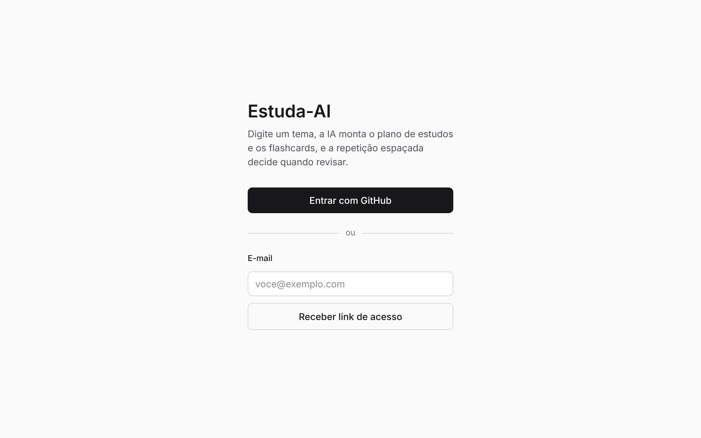

# Estuda-AI

Flashcards de programação gerados por IA e agendados com repetição espaçada.

Você digita um tema (por exemplo, *"índices no PostgreSQL"*), a IA monta um **plano de estudos em etapas** com
flashcards, você revisa e edita o que quiser, e o algoritmo **FSRS** decide quando cada cartão deve voltar.

**Acesse:** [estuda-ai-s5we.vercel.app](https://estuda-ai-s5we.vercel.app) · precisa de uma chave própria da
[Anthropic](https://console.anthropic.com/settings/keys) para gerar planos.

[](https://github.com/lucas-3010/Estuda-AI/actions/workflows/ci.yml)


> Projeto pessoal de estudo e portfólio: Next.js + Supabase (Postgres com RLS) + API do Claude.



## Funcionalidades

- **Gerar plano com IA**: tema + nível (iniciante, intermediário, avançado) + contexto opcional. A IA devolve de 4 a 8
  etapas com 5 a 10 cartões cada. Na prévia dá para editar, apagar ou gerar de novo uma etapa antes de salvar.
- **Revisão com repetição espaçada (FSRS)**: frente → espaço → avaliação em 4 botões (Errei, Difícil, Bom, Fácil) ou
  teclas 1–4. Cada botão mostra quando o cartão volta. Erros voltam ainda na mesma sessão.
- **Painel**: cartões do dia (respeitando o limite de novos por dia) e progresso de cada etapa.
- **Cartões**: busca, filtro por plano, criação e edição manual com Markdown e código com realce de sintaxe.
- **Estatísticas**: revisões por dia (30 dias), taxa de acerto e previsão de carga (14 dias).
- **Login** com GitHub ou link mágico por e-mail.

## Arquitetura

```
Navegador (Next.js, componentes cliente)
  ├─ Supabase JS ──────────────► Postgres (RLS: cada usuário só vê as próprias linhas)
  │    └─ RPC record_review      grava log + novo estado FSRS numa transação
  ├─ ts-fsrs (agenda no cliente)
  └─ POST /api/generate ───────► Route Handler (Node) ──► API do Claude (chave do usuário)
```

| Pasta | O que tem |
|---|---|
| `src/app/` | Rotas (App Router). Páginas autenticadas em `(app)/`, login em `login/`, rota de IA em `api/generate/` |
| `src/components/` | Interface por área: `plan/`, `review/`, `cards/`, `stats/`, `home/` |
| `src/lib/srs/` | Adaptador do FSRS (`fsrs.ts`) e montagem da fila do dia por fuso horário (`queue.ts`) |
| `src/lib/ai/` | Prompt, chamada ao Claude com saída estruturada e mapeamento de erros |
| `src/lib/data/` | Acesso ao Supabase (planos, cartões, revisões, configurações) |
| `src/lib/validation/` | Schemas zod compartilhados entre cliente e servidor |
| `supabase/migrations/` | Tabelas, índices, políticas RLS e funções SQL |
| `supabase/tests/` | Testes pgTAP de segurança (RLS) e das funções |

### Decisões técnicas

- **FSRS em vez de SM-2**: modela a probabilidade de lembrar e agenda a revisão para quando ela cai para a meta
  (90% por padrão), com menos revisões para a mesma retenção.
- **Segurança no banco, não no front**: todas as tabelas têm RLS com `auth.uid() = user_id`. Os logs de revisão só
  podem ser criados pela função `record_review`, que confere o dono do cartão.
- **Cada pessoa usa a própria chave da Anthropic**: a chave fica só no `localStorage` do navegador, vai num header
  apenas na hora de gerar e nunca é gravada nem logada pelo servidor.
- **Saída estruturada + validação**: a IA responde em JSON Schema; o servidor valida com zod e tenta de novo uma vez
  se a resposta vier incompleta. Recusas por política usam o fallback automático da API.
- **Fila por fuso horário**: "vence hoje" é calculado no fim do dia local do usuário, não em UTC.

## Como rodar localmente

Pré-requisitos: Node 22 e Docker (para o Supabase local).

```bash
npm install
npx supabase start            # sobe Postgres, Auth e Mailpit locais e aplica as migrações
npx supabase status -o env    # mostra API_URL e a chave publicável/anon
```

Crie `.env.local`:

```bash
NEXT_PUBLIC_SUPABASE_URL=http://127.0.0.1:54321
NEXT_PUBLIC_SUPABASE_PUBLISHABLE_KEY=<chave publicável ou anon do comando acima>
```

```bash
npm run dev                   # http://127.0.0.1:3000
```

O link mágico de login chega no Mailpit local: http://127.0.0.1:54324.
Para gerar planos, cole uma chave da Anthropic em **Configurações**
([console.anthropic.com](https://console.anthropic.com/settings/keys)).

## Testes

```bash
npm test               # unitários e de componentes (Vitest)
npx supabase test db   # RLS e funções SQL (pgTAP) com o Supabase local
npm run test:db        # alternativa sem Docker: migrações + pgTAP num Postgres comum (ver scripts/)
npm run test:e2e       # fluxo completo no navegador (Playwright), com Supabase local e IA simulada
npm run lint && npm run typecheck
```

A CI do GitHub Actions roda lint, typecheck, testes unitários, build, testes do banco e o teste ponta a ponta.

## Deploy (Supabase + Vercel)

1. Crie um projeto no [Supabase](https://supabase.com/dashboard) e aplique as migrações:
   `npx supabase link --project-ref <ref>` e `npx supabase db push`.
2. Em **Authentication → URL Configuration**, defina a *Site URL* com o domínio da Vercel e adicione
   `https://<seu-dominio>/auth/callback` em *Redirect URLs*.
3. (Opcional) Em **Authentication → Providers → GitHub**, ative o login com GitHub usando um OAuth App do GitHub
   cujo callback é `https://<ref>.supabase.co/auth/v1/callback`.
4. Importe o repositório na [Vercel](https://vercel.com/new) e configure as variáveis
   `NEXT_PUBLIC_SUPABASE_URL` e `NEXT_PUBLIC_SUPABASE_PUBLISHABLE_KEY` (Supabase → Project Settings → API Keys).

## Licença

[MIT](LICENSE)
